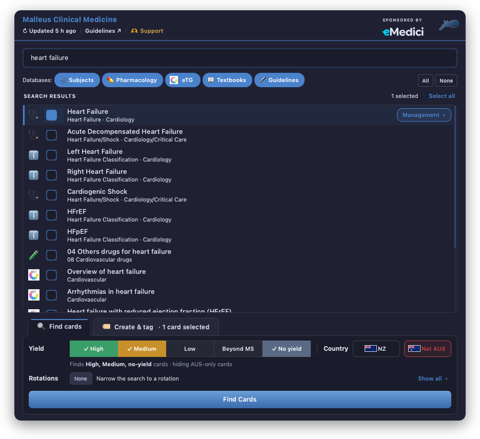
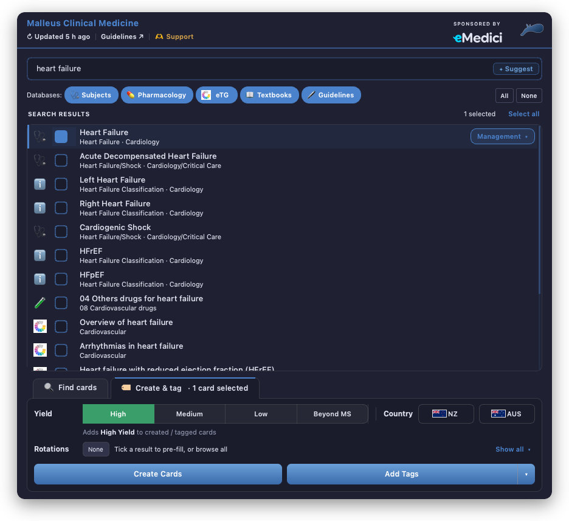
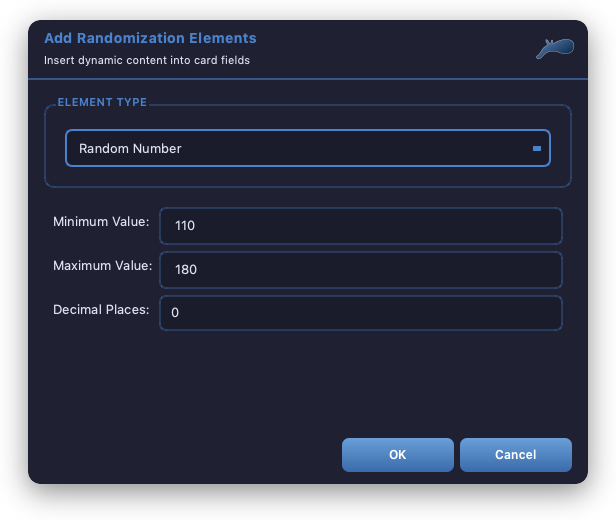

<div align="Center">

# 🌟 Malleus Anki Helper Addon 🌟

<a href="https://malleuscm.notion.site">
    <b>
        The Malleus Clinical Medicine Anki deck is the best continually updated clinical medicine anki deck for Australian and New Zealand medical students.
    </b>
    <div>
        <sup>👉 Visit <u>malleuscm.notion.site</u> to learn more 👈</sup>
    </div>
</a>

<br />

Find, create and tag Malleus cards from inside Anki. One search covers every Malleus database, and the add-on applies the right tags for you.

<br />

• [Malleus Clinical Medicine Website](https://malleuscm.notion.site) •
[AnkiWeb](https://ankiweb.net/shared/info/620451841) •
[Usage](#usage) •
[Installation](#installation) •
[Recent changes](#recent-changes) •

<br />



</div>

## Features

-   **One search across every database:** Subjects, Pharmacology, eTG, Textbooks and Guidelines, ranked together, with filter chips to narrow by database.
-   **Find cards** by topic, filtered by yield (High and Medium by default), country (NZ / AUS) and rotation.
-   **Create and tag cards** with the correct topic tags, subtags, yield, rotations and country features applied automatically.
-   **✦ Suggest tags** from a card's own text, entirely offline.
-   **Add, replace or remove** Malleus tags on many cards at once.
-   **Synced fields:** *Extra (Synced)* and *Additional Resources (Synced)* are filled in from the Malleus databases when you tag a card.
-   **Randomisation:** insert random numbers, lists and score-based answers into cards.
-   **Works offline:** everything runs from a local copy of the databases, which updates itself in the background.

## Showcase

[📺 Watch the how-to and showcase playlist on YouTube](https://www.youtube.com/playlist?list=PLKoggb5cOb9lP5mCR2-2yqdFRe6aaqEaw)

[](https://www.youtube.com/playlist?list=PLKoggb5cOb9lP5mCR2-2yqdFRe6aaqEaw)

## Usage

### Opening the Page Selector

Any of these open it:

-   Press **`Ctrl+Alt+M`** (configurable) in the main window, Browser, Add or Edit windows
-   The **Malleus** button in the Browser toolbar, or **Malleus → Find/Create Malleus Cards**
-   The **Add Malleus Tags** button in the card editor
-   **Tools → Malleus Find/Add Cards** in the main window

Opened from the Browser or an editor, it works on the selected cards. Opened from the main window, it's for finding and creating cards.

### Searching

1.  Type a topic. Results from every database appear together, ranked by relevance. Before you type, it shows the pages you used most recently.
2.  (Optional) Toggle the **database chips** to search only some databases.
3.  Tick the relevant pages, or click **Select all**.
4.  For pages with subtags (e.g. *Management*, *Clinical Features*), pick one from the chip on the ticked row. Leave it on *Main Tag* to cover the whole topic. Shift+click a subtag to apply it to every ticked row.

The panel at the bottom has two tabs: **🔍 Find cards** and **🏷 Create & tag**.

### Finding cards: 🔍 Find cards

-   **Yield:** tick any combination. The default is **High + Medium + no yield** (cards without a yield tag), so low-yield and beyond-medical-student cards are left out. Your choice is remembered.
-   **Country:** click NZ / AUS to cycle **NZ only → Not NZ → off**. "Not" is remembered, so a New Zealand student can hide AUS-only cards permanently.
-   **Rotations:** narrow the search to one or more rotations.
-   Click **Find Cards** (or press Enter) to open the matching cards in the Browser.

The line under the yield buttons summarises what will be searched, e.g. *"Finds High, Medium, no-yield cards · hiding AUS-only cards"*. You can search by yield, country or rotation alone without ticking any pages.

### Creating and tagging cards: 🏷 Create & tag



1.  Search for and tick the pages, as above.
2.  Choose **one yield**. Hover a level to see what it means. Optionally set **NZ only** / **AUS only** and the **Rotations** (pre-filled from the pages you ticked).
3.  Then:
    -   **Create Cards** opens Add Cards with the tags filled in. For eTG, Textbook and Guideline pages it also fills in the *Source* field.
    -   **Add Tags** adds the tags to the selected cards. The **▾** next to it offers:
        -   **Replace Tags:** swap a card's existing tags from one database for the page you ticked.
        -   **Remove Tags:** remove the ticked pages' tags, or all Malleus tags if nothing is ticked.
    -   **✦ Suggest** (in the search box) suggests Subjects pages from the card's own text.

Enter runs **Add Tags** when cards are selected, otherwise **Create Cards**. If you're unsure of a subtag, leave it on *Main Tag*.

Across several cards, every prompt that interrupts a run — the yield level, the Synced Extra picker, and the tag-choice list when replacing — carries an **apply to all** tickbox, so you can answer once and let the rest of the batch run through. The choices are forgotten when the run ends, and the summary at the end says how many cards were resolved from them.

Those prompts also offer the same two ways out: **Skip card** leaves that one card alone and moves on, and **Stop** ends the run there. Stopping keeps the cards already done and tells you how far it got — in **Update Malleus Subject Tags**, **Undo** in the summary then puts everything back, tags and synced fields alike.

### Synced fields

When you tag or create a Subjects or eTG card, the add-on fills two note fields from the Malleus databases:

-   **Extra (Synced):** you choose which extra notes to include in a short dialog.
-   **Additional Resources (Synced):** filled in automatically.

### Browser tools

Right-click selected cards in the Browser for:

-   **Set Yield Level:** change the yield of every selected card in one go.
-   **Update Malleus Subject Tags:** refresh the cards' Subjects tags to the current database. If a page has been renamed or removed, you're asked which page to use instead. Every prompt in a multi-card run has an **apply to all** tickbox, so you can answer once and let the rest of the batch run through unattended — the choices are forgotten when the run ends. Shift+click to skip the yield and Extra (Synced) prompts entirely, and Undo from the summary if needed.

The Browser's **Malleus** menu also has **Update Malleus Database Cache**.

### Randomisation



Click **Add Random** in the card editor to insert a randomisation element at the cursor:

| Element | What it does |
|---|---|
| **Random Number** | a number between a minimum and maximum, to a set number of decimal places |
| **Random List** | one option picked from a list |
| **Scored List** | a list where each option carries a score |
| **Scored Number** | a random number scored by which range it falls in |
| **Show Score** | displays the card's total score: the sum of its scored lists and scored numbers |
| **Answer by Score** | shows different answer text depending on that total score |

The element is inserted as a placeholder such as `[random:110,180,0]`, and the note is tagged `#Malleus_CM::#Card_Feature::Randomisation`. The Malleus note type's card template fills the placeholders in each time the card is shown, so the values change from review to review.

## Keeping the database up to date

The add-on works from a local copy of the Malleus databases, rebuilt from Notion daily. On startup it checks GitHub and downloads only the databases that have changed, so you normally never need to do anything.

To update by hand, click **↻ Updated … ago** at the top of the Page Selector. It turns amber when the copy is over a week old. **Shift+click** rebuilds directly from Notion, which is slower.

## Installation

### Through AnkiWeb (recommended)

In Anki, go to **Tools → Add-ons → Get Add-ons…** and enter:

    620451841

Then restart Anki. [AnkiWeb page](https://ankiweb.net/shared/info/620451841)

### Manual installation

1.  Download this repository.
2.  Place the folder in your Anki add-ons folder:

<details>
<summary>Windows</summary>

> ```
> %APPDATA%\Anki2\addons21\
> ```

</details>

<details>
<summary>macOS</summary>

> ```
> ~/Library/Application Support/Anki2/addons21/
> ```

</details>

<details>
<summary>Linux</summary>

> ```
> ~/.local/share/Anki2/addons21/
> ```

</details>

3.  Restart Anki.

## Configuration

Settings are under **Tools → Add-ons → Malleus Clinical Medicine → Config**. The ones you're most likely to change:

-   `deck_name`: the deck new cards go into. Set it if you've renamed or moved the Malleus deck (use `::` for subdecks).
-   `note_type`: the note type new cards use. Only needed if you have more than one `MalleusCM - Cloze` note type.
-   `shortcut`: the keyboard shortcut for the Page Selector (default `Ctrl+Alt+M`).
-   `find_yields` / `exclude_region_features`: the Find cards yield and country defaults. The Page Selector updates these for you.
-   `show_card_counts`: show how many of your notes are already tagged with each result.

See [config.md](./config.md) for every option.

## Recent changes

-   **October 2026:** Find cards and Create & tag tabs. Searches filter by yield (High + Medium by default) and by country (NZ / AUS only or hidden), and new cards can be tagged NZ- or AUS-only. A simpler, tidier Page Selector.
-   **August 2026:** More reliable database syncing. The database stays up to date after add-on updates.
-   **July 2026:** New Rotations picker, pre-filled from the pages you tick.
-   **June 2026:** Tags are generated inside the add-on from the database structure, plus many quality-of-life improvements and bug fixes. Your local database copy is kept across add-on updates.
-   **April 2026:** One search across all databases with filter chips. Chip-style subtag picker, with Shift+click to apply a subtag to all ticked pages. Design refresh.
-   **March 2026:** ✦ Suggest tags from card text, and eTG tagging generated locally.

## Troubleshooting

-   **Search results look out of date:** click **↻** at the top of the Page Selector and wait for the progress bar to finish before searching.
-   **A card's tags point to a page that no longer exists:** select it in the Browser and use **Update Malleus Subject Tags**.
-   **Something else:** please [open an issue on GitHub](https://github.com/Sabicool/Malleus-Anki-Addon/issues).

## Contributing

-   The databases are rebuilt from Notion daily by a GitHub Action (`.github/workflows/update-cache.yml`) and committed to `cache/`.
-   To rebuild locally, set a Notion token and run `python3 update_notion_cache.py`:

    ``` sh
    NOTION_TOKEN=... python3 update_notion_cache.py
    ```
-   `package.sh` builds the AnkiWeb `.zip`. It reads `NOTION_TOKEN` from the environment or `.env` and never commits it.

## Licence

This project is licensed under the GNU Affero General Public License v3.0 (AGPL-3.0).

This licence grants you the freedom to use, modify, and distribute this software, provided that any derivative work or distribution is also licensed under the AGPL-3.0. Additionally, if you deploy this software on a network, users interacting with it over that network must also be granted access to the source code.

For more details, please refer to the full licence text in the [LICENSE](./LICENSE) file or visit [GNU AGPL-3.0 License](https://www.gnu.org/licenses/agpl-3.0.en.html).
